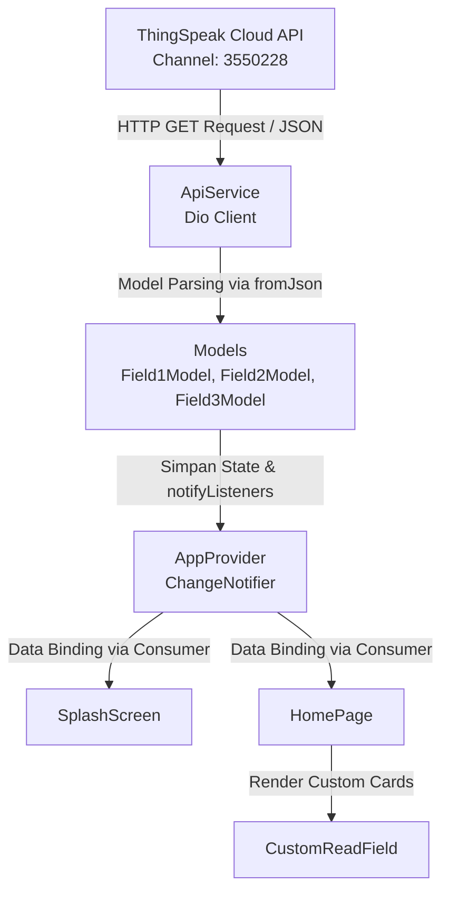

# Agro Tech - MCS BAB 5 🌾

Aplikasi mobile berbasis **Flutter** untuk pemantauan parameter pertanian cerdas (*Smart Agriculture / IoT Monitoring*) secara *real-time*. Aplikasi ini membaca data dari sensor suhu udara, kelembapan udara, dan kelembapan tanah yang terhubung ke platform IoT **ThingSpeak** melalui REST API.

---

## 📑 Daftar Isi
1. [Tentang Proyek](#-tentang-proyek)
2. [Teknologi & Dependensi](#-teknologi--dependensi)
3. [Arsitektur & Alur Data](#-arsitektur--alur-data)
4. [Struktur Direktori `lib/`](#-struktur-direktori-lib)
5. [Penjelasan Lengkap Kode pada `lib/`](#-penjelasan-lengkap-kode-pada-lib)
   - [1. `main.dart`](#1-libmaindart---entry-point-aplikasi)
   - [2. `models/field_model.dart`](#2-libmodelsfield_modeldart---data-model--json-serialization)
   - [3. `services/api_service.dart`](#3-libservicesapi_servicedart---layer-jaringan--rest-api)
   - [4. `providers/app_provider.dart`](#4-libprovidersapp_providerdart---state-management)
   - [5. `screens/splash_screen.dart`](#5-libscreenssplash_screendart---halaman-pembuka)
   - [6. `screens/home_page.dart`](#6-libscreenshome_pagedart---halaman-dashboard-utama)
   - [7. `widget/app_styles.dart`](#7-libwidgetapp_stylesdart---sistem-desain--konstanta)
   - [8. `widget/custom_read_field.dart`](#8-libwidgetcustom_read_fielddart---reusable-widget-sensor)
6. [Catatan & Rekomendasi Peningkatan](#-catatan--rekomendasi-peningkatan)
7. [Cara Menjalankan Aplikasi](#-cara-menjalankan-aplikasi)

---

## 📖 Tentang Proyek

Aplikasi **Agro Tech (MCS BAB 5)** dirancang untuk memvisualisasikan data telemetri dari stasiun sensor pertanian. Data dikirimkan oleh mikrokontroler/sensor ke channel **ThingSpeak**, kemudian aplikasi mengambil data entri terakhir (*last entry*) dari 3 field utama:

| Field ThingSpeak | Parameter Sensor | Satuan / Keterangan |
| :--- | :--- | :--- |
| **Field 1** | Suhu Udara (*Temperature*) | °C |
| **Field 2** | Kelembapan Udara (*Humidity*) | % |
| **Field 3** | Kelembapan Tanah (*Soil Moisture*) | % / Nilai Analog |

---

## 🛠 Teknologi & Dependensi

Proyek ini dibangun menggunakan:
- **Flutter SDK**: `^3.13.5` (Dart SDK compatible)
- **State Management**: [`provider: ^6.1.5+1`](https://pub.dev/packages/provider) — Manajemen state reaktif menggunakan `ChangeNotifier` dan `Consumer`.
- **HTTP Client**: [`dio: ^5.11.1`](https://pub.dev/packages/dio) — Library HTTP client untuk melakukan request ke endpoint ThingSpeak.
- **Typography**: [`google_fonts: ^9.0.0`](https://pub.dev/packages/google_fonts) — Penggunaan font kustom (Roboto).
- **Responsive Preview**: [`device_preview: ^3.0.0`](https://pub.dev/packages/device_preview) — Pengujian tampilan UI di berbagai jenis rasio layar perangkat.

---

## 🔄 Arsitektur & Alur Data

Aplikasi menerapkan pola pemisahan lapisan tanggung jawab (*Separation of Concerns*) yang bersih:



### Penjelasan Siklus Eksekusi:
1. **Aplikasi dimulai** melalui `main()` pada `main.dart`.
2. `AppProvider` diinisialisasi dan langsung mengeksekusi method pengambilan data (`getTemperature()`, `getHumidity()`, `getSoilMoisture()`).
3. `ApiService` membuat request HTTP GET menggunakan **Dio** ke URL API ThingSpeak untuk Field 1, 2, dan 3.
4. Response JSON dipetakan ke objek model Dart (`Field1Model`, `Field2Model`, `Field3Model`).
5. Objek model disimpan di dalam `AppProvider`, lalu memanggil `notifyListeners()`.
6. UI (`SplashScreen` dan `HomePage`) yang dibungkus dengan `Consumer<AppProvider>` otomatis melakukan render ulang (*rebuild*) saat data tersedia.

---

## 📂 Struktur Direktori `lib/`

```
lib/
├── main.dart                      # Titik masuk aplikasi, inisialisasi MultiProvider & DevicePreview
├── models/
│   └── field_model.dart           # Model entitas data & parser JSON untuk ketiga field sensor
├── providers/
│   └── app_provider.dart          # Pengelola state aplikasi & logika bisnis (ChangeNotifier)
├── screens/
│   ├── splash_screen.dart         # Layar pembuka (pengenalan & trigger sinkronisasi awal)
│   └── home_page.dart             # Layar utama yang menampilkan pembacaan ketiga sensor
├── services/
│   └── api_service.dart           # Layar komunikasi jaringan (HTTP REST API ThingSpeak via Dio)
└── widget/
    ├── app_styles.dart            # Kumpulan gaya tipografi, konstanta warna, teks dummy, & aset
    └── custom_read_field.dart     # Komponen UI kartu sensor modular yang dapat digunakan ulang
```

---

## 🔍 Penjelasan Lengkap Kode pada `lib/`

Berikut adalah rincian detail baris demi baris, fungsi, dan tanggung jawab dari setiap file di dalam folder `lib/`:

---

### 1. `lib/main.dart` - Entry Point Aplikasi

File ini adalah pintu masuk utama saat aplikasi dijalankan.

```dart
void main() {
  DevicePreview.enable();
  runApp(MyApp());
}
```

#### Komponen & Logika Utama:
- **`main()`**: Fungsi utama yang mengaktifkan `DevicePreview.enable()` untuk melakukan simulasi tampilan pada resolusi gawai yang berbeda, lalu menjalankan `runApp(MyApp())`.
- **`MyApp` (`StatelessWidget`)**: Root widget aplikasi.
- **`MultiProvider`**: Membungkus widget `MaterialApp` agar state `AppProvider` dapat diakses dari seluruh percabangan widget tree (*global state access*).
- **Cascade Operator (`..`)**:
  ```dart
  ChangeNotifierProvider<AppProvider>(
    create: (context) => AppProvider()
      ..getTemperature()
      ..getHumidity()
      ..getSoilMoisture(),
  )
  ```
  Operator cascade `..` digunakan untuk memanggil fungsi *asynchronous* pengambilan data dari ketiga field sensor tepat saat instance `AppProvider` pertama kali dibuat.
- **Konfigurasi `MaterialApp`**:
  - `title`: `"MCS BAB 5"`
  - `debugShowCheckedModeBanner: false`: Menyembunyikan pita debug di pojok kanan atas.
  - `theme`: Menggunakan Material 3 dengan *color scheme seed* berwarna `Colors.deepPurple`.
  - `home`: Mengarahkan tampilan awal ke `SplashScreen()`.

---

### 2. `lib/models/field_model.dart` - Data Model & JSON Serialization

File ini mendefinisikan struktur data untuk menangani respons dari ThingSpeak API. Endpoint ThingSpeak `last.json` menghasilkan objek JSON dengan format:
```json
{
  "created_at": "2026-03-30T07:15:22Z",
  "entry_id": 105,
  "field1": "29.4"
}
```

File ini mendefinisikan tiga class model yang independen untuk masing-masing field:

#### A. `Field1Model` (Sensor Suhu / Field 1)
- **Atribut**:
  - `DateTime createdAt`: Timestamp saat data dicatat oleh ThingSpeak.
  - `int entryId`: ID unik data entri.
  - `String field1`: Nilai pembacaan sensor suhu (string angka).
- **Konstruktor & Factory**:
  - `Field1Model({required this.createdAt, required this.entryId, required this.field1})`: Konstruktor standar bertipe *required*.
  - `factory Field1Model.fromJson(Map<String, dynamic> json)`: Mengonversi respons `Map` JSON menjadi objek `Field1Model`. Nilai `created_at` di-*parse* ke tipe `DateTime`.
  - `Map<String, dynamic> toJson()`: Serialisasi balik objek Dart ke format `Map` JSON.
- **Helper Functions**:
  - `field1ModelFromJson(String str)`: Mengonversi string JSON langsung ke instance `Field1Model`.
  - `field1ModelToJson(Field1Model data)`: Mengonversi objek `Field1Model` menjadi string JSON.

#### B. `Field2Model` (Sensor Kelembapan Udara / Field 2)
- Struktur identik dengan `Field1Model`, dengan atribut data utama berupa `final String field2` yang merepresentasikan kelembapan udara.

#### C. `Field3Model` (Sensor Kelembapan Tanah / Field 3)
- Struktur identik dengan model sebelumnya, dengan atribut data utama berupa `final String field3` yang merepresentasikan kelembapan tanah.

---

### 3. `lib/services/api_service.dart` - Layer Jaringan & REST API

File ini bertanggung jawab mengisolasi semua operasi I/O jaringan ke server ThingSpeak menggunakan package **Dio**.

```dart
class ApiService {
  Dio dio = Dio();

  final String readKey = "GJALAA6FCFQWBJ6M";

  String fieldUrl1 = "https://api.thingspeak.com/channels/3550228/fields/1/last.json?api_key=";
  String fieldUrl2 = "https://api.thingspeak.com/channels/3550228/fields/2/last.json?api_key="; 
  String fieldUrl3 = "https://api.thingspeak.com/channels/3550228/fields/3/last.json?api_key="; 
  ...
}
```

#### Parameter Konfigurasi:
- **`Channel ID`**: `3550228` (ID channel ThingSpeak tujuan).
- **`readKey`**: `"GJALAA6FCFQWBJ6M"` (Read API Key untuk otentikasi data channel).
- **Endpoint**: Menggunakan path `/fields/{field_id}/last.json` yang secara spesifik meminta hanya 1 rekaman data terbaru, sehingga meminimalkan beban bandwidth data.

#### Method API:
1. **`Future<Field1Model> getField1()`**:
   - Melakukan HTTP GET ke `$fieldUrl1$readKey`.
   - Melakukan deserialisasi data respons via `Field1Model.fromJson(response.data)`.
   - Dilengkapi blok `try-catch` dengan instruksi `rethrow` agar penanganan error dapat diteruskan ke provider.
2. **`Future<Field2Model> getField2()`**:
   - Mengambil data pembacaan Field 2 (Kelembapan) dan mengembalikan objek `Field2Model`.
3. **`Future<Field3Model> getField3()`**:
   - Mengambil data pembacaan Field 3 (Kelembapan Tanah) dan mengembalikan objek `Field3Model`.

---

### 4. `lib/providers/app_provider.dart` - State Management

File ini berfungsi sebagai otak (*business logic controller*) aplikasi yang menghubungkan UI dengan layer service data menggunakan pola **Provider** (`ChangeNotifier`).

```dart
class AppProvider extends ChangeNotifier {
  Field1Model? field1model;
  Field2Model? field2model;
  Field3Model? field3model;
  ...
}
```

#### Variabel State:
- `field1model`: Menyimpan data sensor suhu terbaru (bisa bernilai `null` sebelum data selesai diunduh).
- `field2model`: Menyimpan data kelembapan udara terbaru.
- `field3model`: Menyimpan data kelembapan tanah terbaru.

#### Method & Tanggung Jawab:
- **`goToNextPage({required BuildContext context, required navigationPage})`**:
  - Fungsi utilitas navigasi rute ke halaman berikutnya via `Navigator.push`.
  - Memanggil `notifyListeners()` untuk memperbarui widget observer.
- **`Future getTemperature()`**:
  - Menjalankan `ApiService().getField1()`.
  - Menyimpan hasilnya ke properti `field1model`.
  - Memanggil `notifyListeners()` agar widget consumer menerima notifikasi data baru dan melakukan render ulang.
- **`Future getHumidity()`**:
  - Menjalankan `ApiService().getField2()`, memperbarui `field2model`, dan memberitahu UI listener.
- **`Future getSoilMoisture()`**:
  - Menjalankan `ApiService().getField3()`, memperbarui `field3model`, dan memberitahu UI listener.

---

### 5. `lib/screens/splash_screen.dart` - Halaman Pembuka

Halaman ini berfungsi sebagai tampilan pertama (*onboarding / splash screen*) yang dilihat oleh pengguna.

#### Karakteristik Teknis:
- Dibuat menggunakan **`StatefulWidget`** agar dapat memanfaatkan siklus hidup (*lifecycle*) `initState()`.
- **`initState()`**:
  ```dart
  @override
  void initState() {
    Provider.of<AppProvider>(context, listen: false).getTemperature();
    Provider.of<AppProvider>(context, listen: false).getHumidity();
    Provider.of<AppProvider>(context, listen: false).getSoilMoisture();
    super.initState();
  }
  ```
  Memastikan sinkronisasi data sensor dimulai di latar belakang dengan `listen: false` agar tidak memicu pembaruan widget yang tidak diinginkan selama proses *init*.
- **`Consumer<AppProvider>`**:
  - Membungkus tampilan `Scaffold`.
  - **`AppBar`**: Judul "Agro Tech" di tengah dengan warna latar `AppStyles.mainColor`.
  - **Body**: Menggunakan `ListView` dengan `shrinkWrap: true` dan `NeverScrollableScrollPhysics` agar konten tetap berada di tengah layar (*Center*).
  - **Konten Teks**: Menampilkan teks pengantar aplikasi (`AppStyles.loremIpsum`) dengan alignment `justify`.
  - **Tombol Navigasi**: Tombol kustom "Continue" yang dibungkus `GestureDetector` dengan sudut melengkung (*border radius 24*). Ketika ditekan (`onTap`), pengguna berpindah ke `HomePage()` menggunakan `Navigator.push`.

---

### 6. `lib/screens/home_page.dart` - Halaman Dashboard Utama

Halaman utama yang menampilkan ringkasan data sensor lingkungan secara visual.

#### Karakteristik Teknis:
- Merupakan **`StatelessWidget`** karena reaktivitas data sepenuhnya didelegasikan kepada `AppProvider`.
- Dibungkus dengan **`Consumer<AppProvider>`**, sehingga setiap kali data di provider berubah, tampilan akan otomatis disegarkan.
- **`AppBar`**:
  - Judul: "Agro Tech" (`AppStyles.whiteRoboto14Bold`).
  - `automaticallyImplyLeading: false`: Menonaktifkan tombol kembali bawaan agar pengguna tetap berada di dashboard utama.
- **Body & Kartu Sensor**:
  Menampilkan tiga kartu sensor vertikal menggunakan widget modular `CustomReadField`:
  1. **Kartu Suhu (Field 1)**:
     - `hasil`: `appProvider.field1model!.field1`
     - `warnaBorder`: `AppStyles.mainColor`
     - `gambar`: `AppStyles.gambarThermometer`
  2. **Kartu Kelembapan Udara (Field 2)**:
     - `hasil`: `appProvider.field2model!.field2`
     - `warnaBorder`: `AppStyles.mainColor`
     - `gambar`: `AppStyles.gambarSensorHumidity`
  3. **Kartu Kelembapan Tanah (Field 3)**:
     - `hasil`: `appProvider.field3model!.field3`
     - `warnaBorder`: `AppStyles.mainColor`
     - `gambar`: `AppStyles.gambarSoilAnalysis`

---

### 7. `lib/widget/app_styles.dart` - Sistem Desain & Konstanta

File ini menjadi sentralisasi aturan desain (*Design System*) dan konstanta statis agar aplikasi konsisten dan mudah dirawat.

#### Elemen yang Didefinisikan:
1. **Tipografi (`GoogleFonts.roboto`)**:
   - `roboto14Italic`, `roboto14`, `roboto14SemiBold`, `roboto14Bold`: Font Roboto ukuran 14pt dengan variasi ketebalan (w400, w500, w600, w700).
   - `roboto16Italic`, `roboto16`, `roboto16SemiBold`, `roboto16Bold`: Font Roboto ukuran 16pt untuk teks yang lebih tegas.
   - `whiteRoboto14Bold`: Font Roboto 14pt tebal berwarna putih khusus judul `AppBar` dan teks tombol aksi.
2. **Palet Warna**:
   - `mainColor = Color(0xff36725D)`: Warna hijau lumut/hutan (*forest green*) yang melambangkan nuansa agrikultur dan lingkungan hidup.
3. **Konstanta Teks & Aset**:
   - `loremIpsum`: Teks dummy untuk deskripsi splash screen.
   - `gambarThermometer`: `"thermometer.png"`
   - `gambarSoilAnalysis`: `"soil_analysis.png"`
   - `gambarSensorHumidity`: `"humidity_sensor.png"`

---

### 8. `lib/widget/custom_read_field.dart` - Reusable Widget Sensor

Widget kustom yang berfungsi sebagai komponen kartu visual pembacaan sensor.

```dart
class CustomReadField extends StatelessWidget {
  String hasil;
  Color warnaBorder;
  String gambar;
  ...
}
```

#### Parameter:
- `hasil` (`String`): Angka atau teks nilai sensor yang akan ditampilkan.
- `warnaBorder` (`Color`): Warna garis batas (*border*) kartu.
- `gambar` (`String`): Nama file aset gambar ikon sensor.

#### Struktur Tampilan:
- **`Container`**:
  - Lebar penuh (`double.infinity`) dengan margin horizontal `24px` dan padding vertikal `18px`.
  - `BoxDecoration`: Garis tepi dengan ketebalan 4px (`border: Border.all(...)`) dan sudut melengkung halus `BorderRadius.circular(24)`.
- **`Column`**:
  - `SizedBox` penampung gambar responsif: Menggunakan `MediaQuery.of(context).size.width / 4` agar ukuran gambar proporsional terhadap lebar layar pengguna.
  - `Image.asset(gambar, fit: BoxFit.fill)`: Menampilkan ikon sensor.
  - `SizedBox(height: 14)`: Jarak pemisah antara gambar dan teks.
  - `Center(child: Text(hasil))`: Menampilkan nilai bacaan sensor di posisi tengah.

---

## 💡 Catatan & Rekomendasi Peningkatan

Untuk pengembangan lebih lanjut dari kode yang ada di `lib/`, beberapa hal berikut dapat dipertimbangkan:

1. **Penanganan Null Safety pada `HomePage`**:
   - Pada `home_page.dart`, data dibaca dengan operator *bang* (`appProvider.field1model!.field1`). Jika koneksi lambat atau data belum selesai diunduh saat membuka halaman, aplikasi berisiko melempar error *Null check operator used on a null value*.
   - *Solusi*: Berikan fallback atau indikator pemuatan, contohnya:
     ```dart
     hasil: appProvider.field1model?.field1 ?? "Memuat..."
     ```
2. **Path Aset Lengkap**:
   - Nilai pada `AppStyles.gambarThermometer` saat ini adalah `"thermometer.png"`. Di Flutter, pemanggilan aset lokal dari folder `assets/` biasanya memerlukan path lengkap:
     ```dart
     static String gambarThermometer = "assets/thermometer.png";
     ```
3. **Efisiensi Panggilan API**:
   - Di `main.dart`, `..getTemperature()` dan method lainnya telah dipanggil secara berantai. Di `splash_screen.dart`, method yang sama dipanggil ulang di `initState()`. Menghilangkan salah satunya akan menghemat kuota request API ThingSpeak (khususnya untuk akun gratis dengan batas jeda per request).

---

## 🚀 Cara Menjalankan Aplikasi

1. **Pastikan Flutter SDK terpasang**:
   ```bash
   flutter --version
   ```

2. **Unduh semua paket dependensi**:
   ```bash
   flutter pub get
   ```

3. **Jalankan aplikasi di emulator atau perangkat fisik**:
   ```bash
   flutter run
   ```
